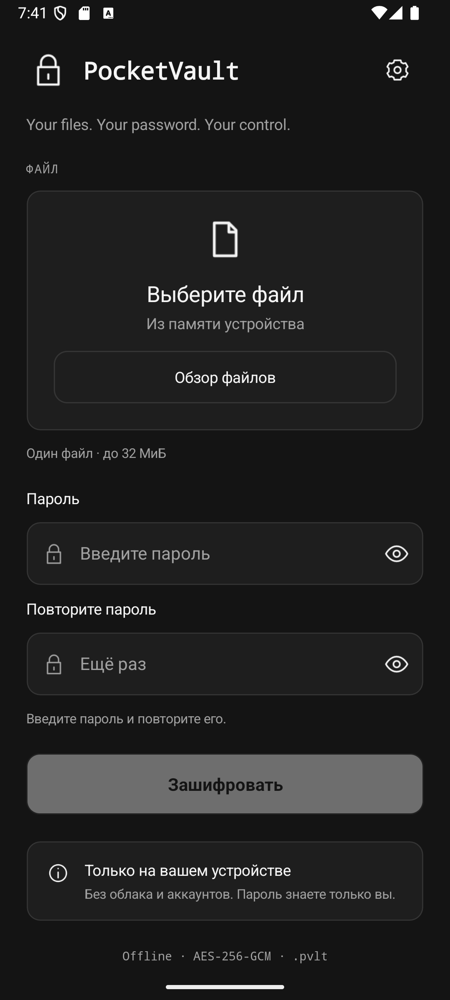
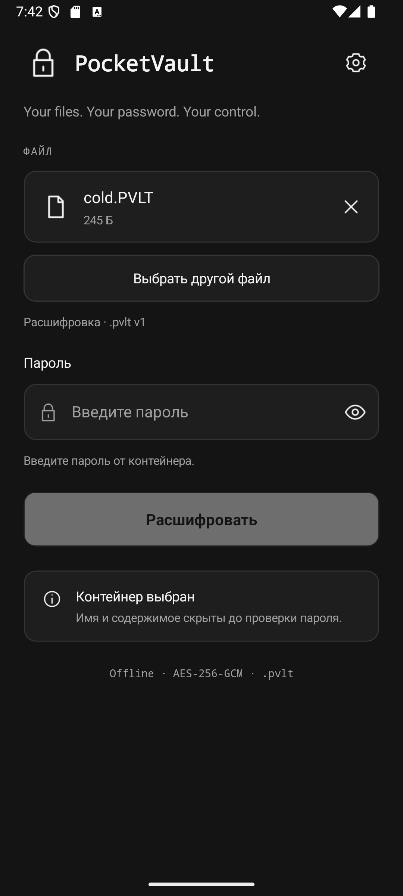

<p align="center"><a href="README.md">English</a> · <a href="docs/README.ru.md">Русский</a></p>

<p align="center"></p>

<h1 align="center">PocketVault</h1>
<p align="center"><strong>Your files. Your password. Your control.</strong></p>
<p align="center">An offline file encryption app for Windows and Android, sharing the same password-protected <code>.pvlt</code> v1 format.</p>

<p align="center">
  <a href="https://github.com/Lantsov/pocket-vault/actions/workflows/build.yml"></a>
  <a href="https://github.com/Lantsov/pocket-vault/releases/latest"></a>
  
  
  <a href="LICENSE"></a>
</p>

<p align="center"><a href="https://github.com/Lantsov/pocket-vault/releases/latest"><strong>Download PocketVault</strong></a> · <a href="docs/SECURITY_MODEL.md">Security model</a> · <a href="docs/README.ru.md">По-русски</a></p>

## Preview

<p align="center"></p>

The current application interface is in Russian. [Decryption](docs/images/pocketvault-decrypt.png) · [Processing](docs/images/pocketvault-processing.png).

<p align="center"> </p>

These are actual Android emulator screenshots with synthetic data. **Windows: 1.1.1; Android: 1.0.0 release candidate; container format: v1.** Android distribution is pending the owner's release signing key. [Android build, installation and verified testing scope](docs/ANDROID.md).

## Why PocketVault

- **Fully offline.** No accounts, network requests or telemetry in the application.
- **Password-based encryption.** AES-256-GCM with a fresh salt and nonce for each container.
- **Compression first.** The file name and contents sit inside an encrypted ZIP.
- **A compact Windows app.** Portable WPF interface, drag and drop, and optional Explorer integration.
- **Native interfaces.** WPF on Windows; .NET MAUI and Android's system document picker on Android.

## Download

Windows 1.1.1 is published below. Android 1.0.0 has no published production-signed APK yet; follow the [Android guide](docs/ANDROID.md) for clearly labelled development builds and local release signing.

Download and extract an archive from the [latest release](https://github.com/Lantsov/pocket-vault/releases/latest). Both builds target **Windows x64** on a Windows version supported by .NET 10.

| Build | Choose this when… |
| --- | --- |
| [Self-contained ZIP](https://github.com/Lantsov/pocket-vault/releases/latest) | You want a standalone EXE; no .NET installation is needed. Native runtime libraries extract on first launch. |
| [Framework-dependent ZIP](https://github.com/Lantsov/pocket-vault/releases/latest) | You already have [.NET Desktop Runtime 10 x64](https://dotnet.microsoft.com/en-us/download/dotnet/10.0). Keep the entire extracted folder. |

Compare the archive's `Get-FileHash -Algorithm SHA256` result with [SHA256SUMS.txt](https://github.com/Lantsov/pocket-vault/releases/latest). Checksums detect differing bytes; they do not establish publisher identity if the download source is compromised.

The EXE is **unsigned**. Windows SmartScreen may warn about an unknown publisher. Review the source and download origin before deciding whether to run it. There is no installer and normal use does not require administrator rights.

## How it works

1. Choose or drop one file into the window.
2. Enter a password and repeat it. Case and spaces matter.
3. Select **Зашифровать** (Encrypt) and save the `.pvlt` container.
4. To restore, open the `.pvlt`, enter the password, select **Расшифровать** (Decrypt), and choose an output folder.

Existing output files are never overwritten. Originals are kept by default. Optional deletion requires confirmation and a read-back check of the saved container; it is ordinary deletion, not secure erasure. See the [usage guide](docs/USAGE.md) for Explorer registration and keyboard controls.

## Security

Format v1 derives a 256-bit key with **PBKDF2-HMAC-SHA256, 600,000 iterations**, using an independently generated **16-byte salt**. **AES-256-GCM** uses a random **12-byte nonce** and a **16-byte authentication tag**. The complete 52-byte header is authenticated as AAD. Authentication finishes before the ZIP is opened or restored content is written.

The original name and contents are encrypted. The container header, encrypted length and filesystem metadata remain visible. Password guesses can be tested offline, so a long, unique passphrase matters. Read the [security model](docs/SECURITY_MODEL.md), [format specification](docs/FORMAT.md) and [vulnerability reporting policy](SECURITY.md).

## Limitations

- One regular file, up to **128 MiB on Windows / 32 MiB on Android**; no folders or batch processing. Windows containers exceeding Android's limit cannot be restored on Android.
- ZIP and encryption run in memory and can require hundreds of MiB, approaching 1 GiB in some operations.
- No password recovery, operation cancellation, secure erasure or independent cryptographic audit.
- Windows restoration uses a plaintext temporary file in the destination folder. A crash can leave it behind. Android writes through the selected DocumentsProvider, which can retain partial files after interruption.
- Source and restored documents may be readable by other apps, document providers and indexers. Android does not delete originals. Secure erasure is not implemented on either platform.
- File contents and name are restored; NTFS permissions, alternate streams and other metadata are not preserved separately.

## Building from source

On Windows x64 with a stable .NET 10 SDK:

```powershell
dotnet build PocketVault.slnx -c Release
dotnet run --project PocketVault.Tests -c Release
.\scripts\build.ps1 -Publish
```

The tests use a standalone console runner, including real WPF windows. `dotnet test` does **not** execute them. See [build, publish and screenshot instructions](docs/BUILD.md).

## Documentation

[Usage](docs/USAGE.md) · [Android](docs/ANDROID.md) · [Security model](docs/SECURITY_MODEL.md) · [Container format](docs/FORMAT.md) · [Build guide](docs/BUILD.md) · [Changelog](CHANGELOG.md) · [Русская версия](docs/README.ru.md)

## Contributing

Small, focused fixes are welcome. Read [CONTRIBUTING.md](CONTRIBUTING.md); changes to cryptography or the file format need particular care for compatibility. Please report suspected vulnerabilities privately as described in [SECURITY.md](SECURITY.md).

## License

[MIT](LICENSE), copyright © 2026 Lantsov. See [third-party notices](docs/THIRD_PARTY_NOTICES.md) for runtime distribution information.

## Disclaimer

Provided **AS IS**, under the MIT license. PocketVault has not undergone an independent cryptographic audit; implementation security is not guaranteed. You are responsible for passwords and backups, and losing a password may make recovery impossible. It does not protect a compromised OS or stop malware and keyloggers. Ordinary deletion leaves possible copies, indexes, thumbnails and disk remnants; a crash may leave plaintext temporary files. Do not rely on it as the only protection for critical data without an independent risk assessment. [Full disclaimer / полный отказ от гарантий](docs/DISCLAIMER.md).
