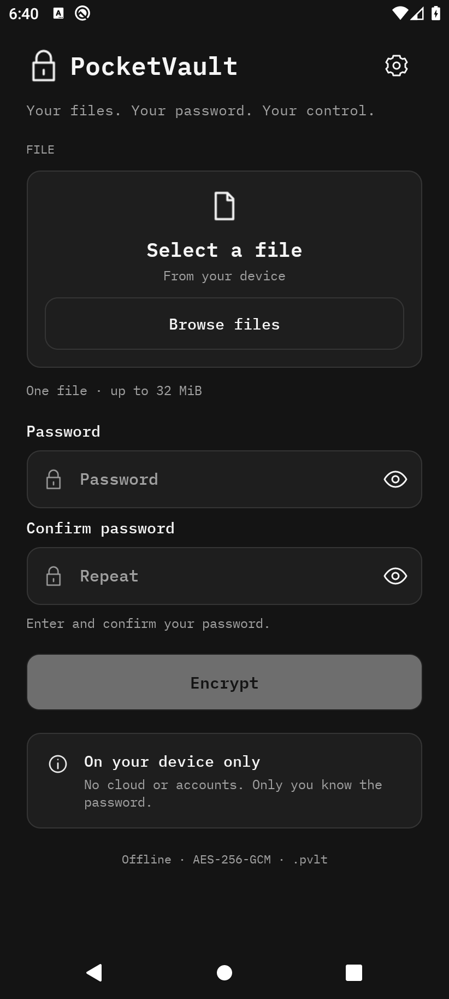

<p align="center">
  <a href="README.md">English</a> · <a href="docs/README.ru.md">Русский</a>
</p>

<p align="center"></p>
<h1 align="center">PocketVault</h1>
<p align="center"><strong>Your files. Your password. Your control.</strong></p>
<p align="center">Simple, offline file encryption for <strong>Windows</strong> and <strong>Android</strong>.<br>One password-protected <code>.pvlt</code> format, compatible across both platforms.</p>

<p align="center">
  <a href="https://github.com/Lantsov/pocket-vault/actions/workflows/build.yml"></a>
  <a href="https://github.com/Lantsov/pocket-vault/actions/workflows/android.yml"></a>
  <a href="LICENSE"></a>
</p>

<p align="center">
  <a href="https://github.com/Lantsov/pocket-vault/releases/tag/v1.1.1"><strong>Download for Windows</strong></a>
  ·
  <a href="https://github.com/Lantsov/pocket-vault/releases/tag/android-v1.0.0"><strong>Download for Android</strong></a>
</p>

## Preview

<p align="center"></p>
<p align="center"><em>Windows · WPF · Russian interface</em></p>
<p align="center">
  
  &nbsp;
  
</p>
<p align="center"><em>Android · IBM Plex Mono · Russian / English · actual emulator screenshots with sample data</em></p>

## Downloads

| Platform | Release | Download | Requirements |
| --- | --- | --- | --- |
| **Windows** | **1.1.1** | [Self-contained ZIP](https://github.com/Lantsov/pocket-vault/releases/download/v1.1.1/PocketVault-1.1.1-win-x64-self-contained.zip) | Windows x64; no separate .NET installation |
| Windows | 1.1.1 | [Framework-dependent ZIP](https://github.com/Lantsov/pocket-vault/releases/download/v1.1.1/PocketVault-1.1.1-win-x64-framework-dependent.zip) | Windows x64 and .NET Desktop Runtime 10 x64 |
| **Android** | **1.0.0** | [Signed ARM64 APK](https://github.com/Lantsov/pocket-vault/releases/download/android-v1.0.0/PocketVault-1.0.0-android-arm64-release.apk) | Android 10+ (API 29), ARM64 |

Verify downloads against the **SHA256SUMS.txt** attached to the corresponding [Windows release](https://github.com/Lantsov/pocket-vault/releases/tag/v1.1.1) or [Android release](https://github.com/Lantsov/pocket-vault/releases/tag/android-v1.0.0). The Android release also includes the public signing-certificate fingerprint. Checksums detect file changes but do not independently establish publisher identity.

**Windows:** extract the ZIP, then run PocketVault.exe. The Windows EXE is not digitally signed; SmartScreen may show an unknown-publisher warning. **Android:** download the APK and allow installation from your chosen source. It is not distributed through Google Play.

## Features

- **Private by design:** local file processing, no account, telemetry or server-side encryption.
- **Compatible files:** encrypt on Windows, decrypt on Android — or the reverse — using the same `.pvlt` v1 format.
- **Authenticated encryption:** AES-256-GCM; PBKDF2-HMAC-SHA256 (600,000 iterations) derives a key from your password.
- **File name protection:** the original file name and contents are kept inside an encrypted ZIP.
- **Minimal interfaces:** dark WPF desktop app; mobile UI with English/Russian localization, system-language selection and IBM Plex Mono.
- **System file access:** drag and drop / optional Explorer integration on Windows; Android system document picker (SAF), without broad storage access.

## Quick start

1. Choose **one file**.
2. Enter a strong password (and confirm it when encrypting).
3. Encrypt and save the `.pvlt` container.
4. To restore, choose the container, enter the same password and save the decrypted file.

The password cannot be recovered. Keep reliable backups and test restoration before removing any original file. See the [Windows usage guide](docs/USAGE.md) and [Android guide](docs/ANDROID.md).

## Security & limitations

| | Windows | Android |
| --- | --- | --- |
| Maximum original/restored file | **128 MiB** | **32 MiB** |
| Interface | WPF; Russian | .NET MAUI; English and Russian |
| File selection | Local paths / Explorer | System document picker |
| Original file deletion | Optional, verified, **not secure erasure** | Not supported |

PocketVault processes files in memory; large files may consume significant RAM. Windows decryption temporarily writes plaintext in the target directory; interrupted Android document-provider writes may leave partial files. External metadata and file sizes can remain visible. PocketVault cannot protect files on a compromised device, and **has not undergone an independent cryptographic audit**.

Use a long, unique passphrase. Read the [security model](docs/SECURITY_MODEL.md), [container format](docs/FORMAT.md), [disclaimer](docs/DISCLAIMER.md) and [security reporting policy](SECURITY.md) before relying on the application for important data.

## Build from source

Windows (stable .NET 10 SDK):

```powershell
dotnet build PocketVault.slnx -c Release
dotnet run --project PocketVault.Tests -c Release
.\scripts\build.ps1 -Publish
```

Android requires .NET MAUI, Android SDK and JDK 21. Follow [docs/ANDROID.md](docs/ANDROID.md) for debug/release build and signing instructions. The standalone Windows test runner is **not** invoked by `dotnet test`.

## Project

[Windows guide](docs/USAGE.md) · [Android guide](docs/ANDROID.md) · [Build](docs/BUILD.md) · [Changelog](CHANGELOG.md) · [Contributing](CONTRIBUTING.md) · [License](LICENSE) · [Third-party notices](docs/THIRD_PARTY_NOTICES.md)

Licensed under **MIT**, © 2026 Lantsov. The software is provided **AS IS**, without warranties. Report vulnerabilities privately via [SECURITY.md](SECURITY.md).
