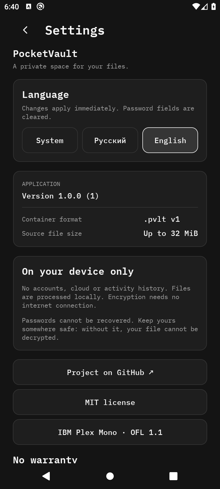

<p align="center">
  <a href="../README.md">English</a> · <a href="README.ru.md">Русский</a>
</p>

<p align="center"></p>
<h1 align="center">PocketVault</h1>
<p align="center"><strong>Ваши файлы. Ваш пароль. Ваш контроль.</strong></p>
<p align="center">Простое офлайн-шифрование файлов для <strong>Windows</strong> и <strong>Android</strong>.<br>Один защищённый паролем формат <code>.pvlt</code>, совместимый на обеих платформах.</p>

<p align="center">
  <a href="https://github.com/Lantsov/pocket-vault/actions/workflows/build.yml"></a>
  <a href="https://github.com/Lantsov/pocket-vault/actions/workflows/android.yml"></a>
  <a href="../LICENSE"></a>
</p>

<p align="center">
  <a href="https://github.com/Lantsov/pocket-vault/releases/tag/v1.1.1"><strong>Скачать для Windows</strong></a>
  ·
  <a href="https://github.com/Lantsov/pocket-vault/releases/tag/android-v1.0.0"><strong>Скачать для Android</strong></a>
</p>

## Интерфейс

<p align="center"></p>
<p align="center"><em>Windows · WPF · русский язык</em></p>
<p align="center">
  
  &nbsp;
  
</p>
<p align="center"><em>Android · IBM Plex Mono · русский / английский · реальные снимки эмулятора с тестовыми данными</em></p>

## Скачать

| Платформа | Версия | Скачать | Требования |
| --- | --- | --- | --- |
| **Windows** | **1.1.1** | [Автономный ZIP](https://github.com/Lantsov/pocket-vault/releases/download/v1.1.1/PocketVault-1.1.1-win-x64-self-contained.zip) | Windows x64; .NET отдельно не нужен |
| Windows | 1.1.1 | [Компактный ZIP](https://github.com/Lantsov/pocket-vault/releases/download/v1.1.1/PocketVault-1.1.1-win-x64-framework-dependent.zip) | Windows x64 и .NET Desktop Runtime 10 x64 |
| **Android** | **1.0.0** | [Подписанный APK ARM64](https://github.com/Lantsov/pocket-vault/releases/download/android-v1.0.0/PocketVault-1.0.0-android-arm64-release.apk) | Android 10+ (API 29), ARM64 |

Проверьте SHA-256 по файлу **SHA256SUMS.txt** из соответствующего [релиза Windows](https://github.com/Lantsov/pocket-vault/releases/tag/v1.1.1) или [релиза Android](https://github.com/Lantsov/pocket-vault/releases/tag/android-v1.0.0). Для Android опубликован также отпечаток сертификата подписи. Контрольные суммы обнаруживают изменение файла, но сами по себе не подтверждают личность издателя.

**Windows:** распакуйте ZIP и запустите PocketVault.exe. EXE не подписан цифровой подписью: SmartScreen может предупредить о неизвестном издателе. **Android:** скачайте APK и разрешите установку из выбранного источника. В Google Play приложения пока нет.

## Возможности

- **Приватность:** файлы обрабатываются локально; без аккаунтов, телеметрии и серверного шифрования.
- **Общий формат:** можно зашифровать файл на Windows и восстановить на Android — или наоборот.
- **Шифрование:** AES-256-GCM и PBKDF2-HMAC-SHA256 с 600 000 итераций.
- **Защита имени:** исходное имя и содержимое находятся внутри зашифрованного ZIP.
- **Минималистичный интерфейс:** тёмная Windows-версия и мобильный интерфейс с русским/английским языками и шрифтом IBM Plex Mono.
- **Системная работа с файлами:** перетаскивание и интеграция с Проводником в Windows; системный выбор документов Android (SAF) без полного доступа к накопителю.

## Как пользоваться

1. Выберите **один файл**.
2. Введите надёжный пароль (при шифровании — дважды).
3. Зашифруйте файл и сохраните контейнер `.pvlt`.
4. Для восстановления откройте контейнер, введите тот же пароль и сохраните исходный файл.

Восстановить забытый пароль нельзя. Храните резервные копии и проверяйте расшифровку до удаления оригиналов. Подробности: [Windows](USAGE.md) · [Android](ANDROID.md).

## Безопасность и ограничения

| | Windows | Android |
| --- | --- | --- |
| Максимальный размер файла | **128 МиБ** | **32 МиБ** |
| Интерфейс | WPF; русский | .NET MAUI; русский и английский |
| Выбор файлов | Локальные пути / Проводник | Системный выбор документов |
| Удаление оригинала | По желанию, с проверкой; **не безопасное стирание** | Не поддерживается |

Обработка происходит в памяти, поэтому крупные файлы могут требовать много ОЗУ. В Windows при восстановлении создаётся временный открытый файл в целевой папке; при сбое Android-провайдера может остаться частичный документ. Размер контейнера и внешние метаданные не скрываются. Программа не защищает от вредоносного ПО на заражённом устройстве и **не проходила независимый криптографический аудит**.

Используйте длинную уникальную парольную фразу. Подробнее: [модель безопасности](SECURITY_MODEL.md), [формат контейнера](FORMAT.md), [отказ от гарантий](DISCLAIMER.md), [сообщение об уязвимости](../SECURITY.md).

## Сборка из исходников

Windows (стабильный .NET 10 SDK):

```powershell
dotnet build PocketVault.slnx -c Release
dotnet run --project PocketVault.Tests -c Release
.\scripts\build.ps1 -Publish
```

Для Android нужны .NET MAUI, Android SDK и JDK 21. Инструкция по сборке и подписи — в [ANDROID.md](ANDROID.md). Проверки Windows запускаются отдельной программой, **не** через `dotnet test`.

## Проект

[Windows](USAGE.md) · [Android](ANDROID.md) · [Сборка](BUILD.md) · [История](../CHANGELOG.md) · [Участие](../CONTRIBUTING.md) · [Лицензия](../LICENSE) · [Сторонние лицензии](THIRD_PARTY_NOTICES.md)

Лицензия **MIT**, © 2026 Lantsov. Приложение предоставляется **«как есть»**, без гарантий. Об уязвимостях сообщайте приватно по [SECURITY.md](../SECURITY.md).
