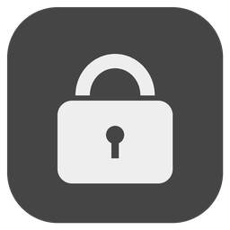
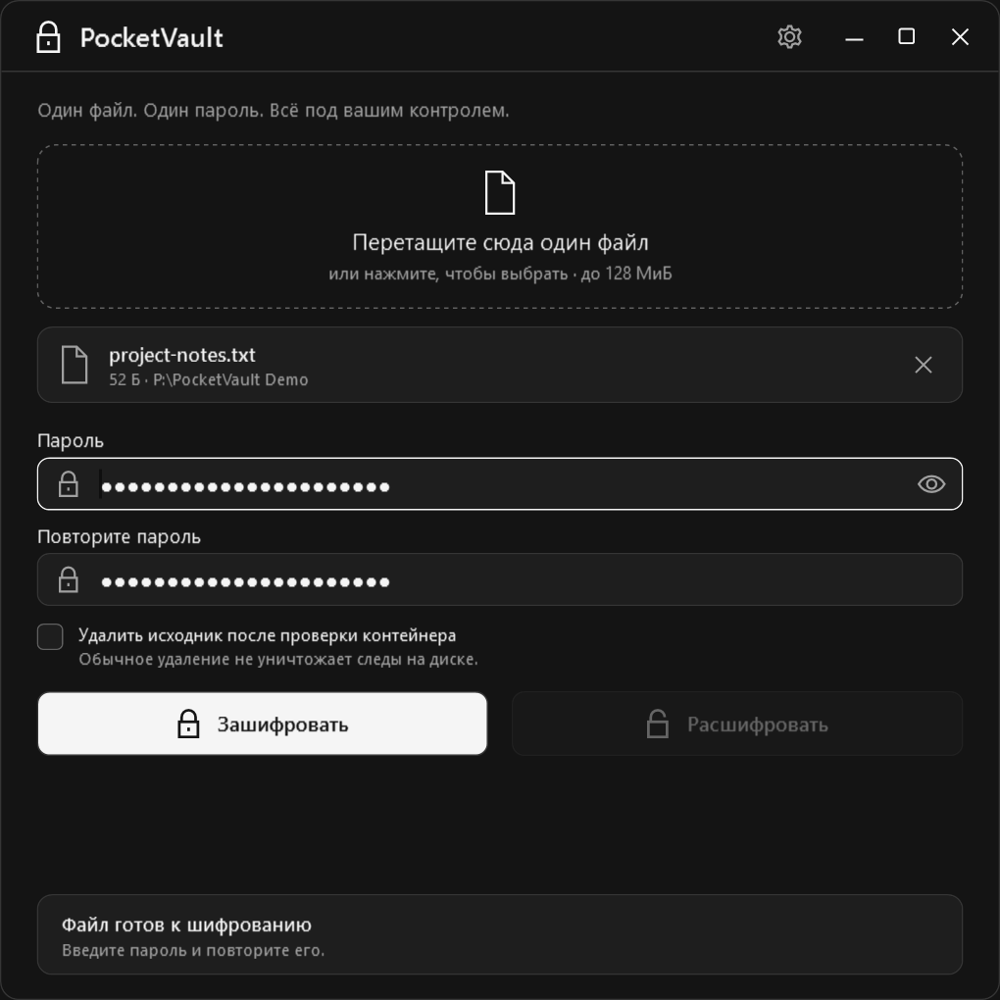
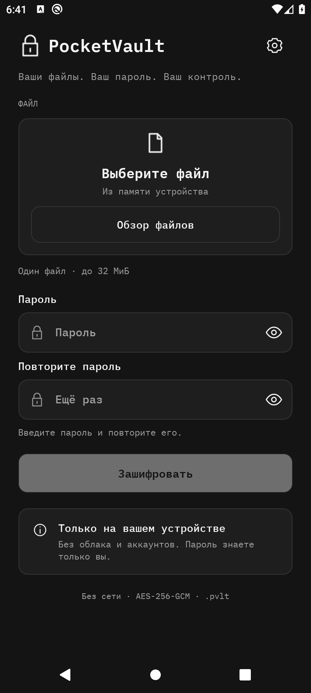
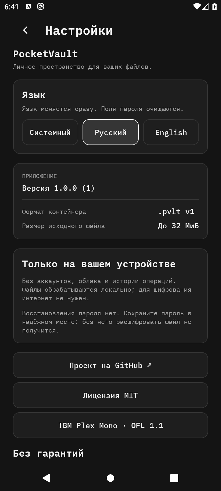

<p align="center"><a href="../README.md">English</a> · <a href="README.ru.md">Русский</a></p>

<p align="center"></p>

<h1 align="center">PocketVault</h1>
<p align="center"><strong>Ваши файлы. Ваш пароль. Ваш контроль.</strong></p>
<p align="center">Офлайн-приложение для Windows и Android: шифрование файлов в общем защищённом паролем формате <code>.pvlt</code> v1.</p>

<p align="center">
  <a href="https://github.com/Lantsov/pocket-vault/actions/workflows/build.yml"></a>
  <a href="https://github.com/Lantsov/pocket-vault/releases/latest"></a>
  
  
  <a href="../LICENSE"></a>
</p>

<p align="center"><a href="https://github.com/Lantsov/pocket-vault/releases/latest"><strong>Скачать PocketVault</strong></a> · <a href="SECURITY_MODEL.md">Модель безопасности</a> · <a href="../README.md">English</a></p>

## Интерфейс

<p align="center"></p>

Интерфейс Windows — на русском языке. [Расшифровка](images/pocketvault-decrypt.png) · [Обработка файла](images/pocketvault-processing.png).

<p align="center"> </p>

Это реальные снимки Android-эмулятора с синтетическими данными. Android поддерживает русский и английский с мгновенным переключением. [Компактный UI, снимки RU/EN и границы проверки](ANDROID_PLEX_POLISH.md). **Windows: 1.1.1; Android: кандидат 1.0.0; формат контейнера: v1.** Предыдущий ARM64-кандидат подписан владельцем и проверен на Poco X6 Pro; обновлённый UI перед распространением требует новой сборки с тем же ключом. [Инструкция Android](ANDROID.md).

## Почему PocketVault

- **Полностью офлайн.** Приложение не использует аккаунты, сетевые запросы или телеметрию.
- **Шифрование с паролем.** AES-256-GCM, новая случайная соль и nonce для каждого контейнера.
- **Сначала сжатие.** Имя и содержимое файла находятся внутри зашифрованного ZIP.
- **Компактное приложение Windows.** Переносимый WPF-интерфейс, перетаскивание файла и добровольная интеграция с Проводником.
- **Нативные интерфейсы.** WPF в Windows; .NET MAUI и системный выбор документов в Android.

## Скачать

Windows 1.1.1 опубликован по ссылкам ниже. Подписанный владельцем Android APK подготовлен локально, но не опубликован в GitHub Releases; [инструкция Android](ANDROID.md) содержит SHA-256, отпечаток сертификата, установку и порядок локальной подписи.

Скачайте и распакуйте архив из [последнего релиза](https://github.com/Lantsov/pocket-vault/releases/latest). Обе сборки рассчитаны на **Windows x64** и версию Windows, поддерживаемую .NET 10.

| Сборка | Когда выбрать |
| --- | --- |
| [Автономный ZIP](https://github.com/Lantsov/pocket-vault/releases/latest) | Нужен самостоятельный EXE без установки .NET. При первом запуске распаковываются нативные библиотеки среды. |
| [Компактный ZIP](https://github.com/Lantsov/pocket-vault/releases/latest) | Уже установлен [.NET Desktop Runtime 10 x64](https://dotnet.microsoft.com/ru-ru/download/dotnet/10.0). Переносите всю распакованную папку. |

Сравните результат `Get-FileHash -Algorithm SHA256` для архива с [SHA256SUMS.txt](https://github.com/Lantsov/pocket-vault/releases/latest). Суммы выявляют различие байтов, но не подтверждают издателя при компрометации источника загрузки.

EXE **не подписан**. Windows SmartScreen может предупредить о неизвестном издателе. Перед запуском оцените исходники и источник загрузки. Установщика нет; обычная работа не требует прав администратора.

## Как пользоваться

1. Выберите или перетащите один файл в окно.
2. Введите и повторите пароль. Регистр и пробелы имеют значение.
3. Нажмите **Зашифровать** и сохраните контейнер `.pvlt`.
4. Для восстановления откройте `.pvlt`, введите пароль, нажмите **Расшифровать** и выберите выходную папку.

Существующие файлы не перезаписываются. Исходник по умолчанию сохраняется. Его удаление требует подтверждения и повторного чтения с проверкой записанного контейнера; это обычное удаление, без безопасного уничтожения данных. Регистрация в Проводнике и клавиатурное управление описаны в [руководстве](USAGE.md).

## Безопасность

Формат v1 получает 256-битный ключ через **PBKDF2-HMAC-SHA256, 600 000 итераций**, с независимо сгенерированной **16-байтовой солью**. **AES-256-GCM** использует случайный **12-байтовый nonce** и **16-байтовый тег аутентификации**. Все 52 байта заголовка аутентифицируются как AAD. Аутентификация завершается до открытия ZIP и записи восстановленного содержимого.

Имя и содержимое исходника зашифрованы. Заголовок, длина шифротекста и метаданные файловой системы остаются видимыми. Пароли можно подбирать офлайн: используйте длинную уникальную парольную фразу. Подробнее: [модель безопасности](SECURITY_MODEL.md), [формат](FORMAT.md), [сообщения об уязвимостях](../SECURITY.md).

## Ограничения

- Один обычный файл до **128 МиБ в Windows / 32 МиБ в Android**; папки и пакетная обработка не поддерживаются. Windows-контейнеры с данными свыше лимита Android на телефоне не восстановить.
- ZIP и шифрование выполняются в памяти: потребление может достигать сотен МиБ, в отдельных операциях — приближаться к 1 ГиБ.
- Нет восстановления пароля, отмены операции, безопасного стирания или независимого криптографического аудита.
- В Windows открытые данные записываются во временный файл целевой папки. После аварии он может остаться. Android пишет через выбранный DocumentsProvider; прерывание может оставить частичный файл.
- Исходные и расшифрованные документы могут быть доступны другим приложениям, провайдерам и индексаторам. Android сохраняет исходники. Безопасное удаление не реализовано на обеих платформах.
- Восстанавливаются имя и содержимое; права NTFS, альтернативные потоки и другие метаданные отдельно не сохраняются.

## Сборка из исходников

На Windows x64 со стабильным .NET 10 SDK:

```powershell
dotnet build PocketVault.slnx -c Release
dotnet run --project PocketVault.Tests -c Release
.\scripts\build.ps1 -Publish
```

Тесты запускаются отдельной консольной программой и открывают настоящие окна WPF. `dotnet test` **не** выполняет эти проверки. Подробнее: [сборка, публикация и снимки](BUILD.md).

## Документация

[Использование](USAGE.md) · [Android](ANDROID.md) · [Модель безопасности](SECURITY_MODEL.md) · [Формат контейнера](FORMAT.md) · [Сборка](BUILD.md) · [История изменений](../CHANGELOG.md) · [English](../README.md)

## Участие

Небольшие исправления приветствуются. Прочитайте [CONTRIBUTING.md](../CONTRIBUTING.md): изменения криптографии и формата требуют особого внимания к совместимости. О возможных уязвимостях сообщайте приватно по правилам [SECURITY.md](../SECURITY.md).

## Лицензия

[MIT](../LICENSE), copyright © 2026 Lantsov. Сведения о поставляемой среде выполнения — в [уведомлениях о сторонних компонентах](THIRD_PARTY_NOTICES.md).

## Отказ от гарантий

Программа предоставляется **AS IS («как есть»)** по лицензии MIT. Независимый криптографический аудит не проводился; безопасность реализации не гарантируется. Пользователь отвечает за пароли и резервные копии; потеря пароля может сделать восстановление невозможным. Программа не защищает скомпрометированную ОС и не противодействует вредоносному ПО и кейлоггерам. После обычного удаления могут сохраняться копии, индексы, миниатюры и остаточные данные; после аварии — временные файлы с открытыми данными. Не используйте её как единственную защиту критически важных данных без независимой оценки рисков. [Полный текст / full disclaimer](DISCLAIMER.md).
